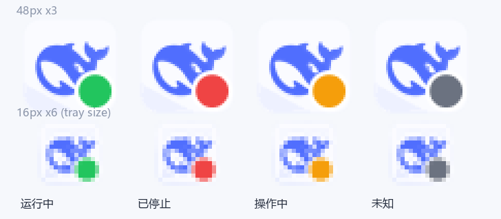
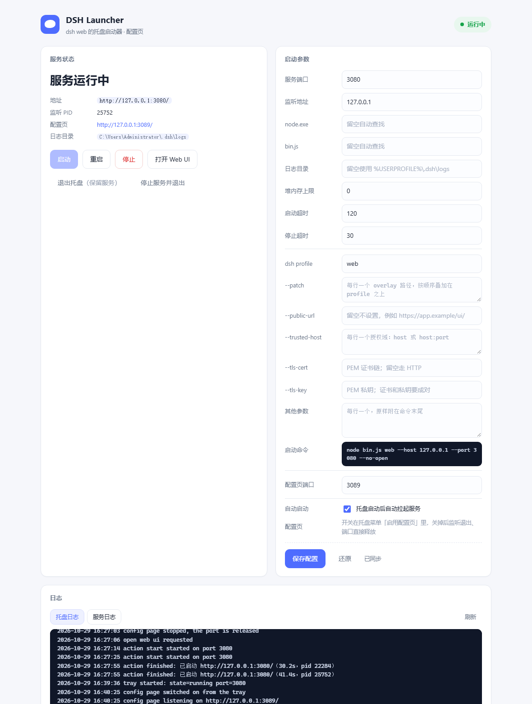

# DSH Launcher

给 [DSH](https://github.com/deepseek-ai) 的 `dsh web` 服务配一个 Windows 托盘：**双击就驻留，点菜单就启停**，不用再守着终端窗口。

纯 Rust 实现，产物是一个单文件 `dsh-launcher.exe`（约 760 KB），不依赖 PowerShell 脚本、不需要 Node 之外的任何运行时。



左侧为 48px 系统托盘尺寸的放大版，右下角小图为真实 16px。

## 特性

- **图标即状态**：DeepSeek 鲸鱼图标，右下角圆点显示运行状态
  - 绿色 `#22C55E` 运行中 · 红色 `#EF4444` 已停止 · 橙色 `#F59E0B` 正在操作 · 灰色未知
- **不后台空转**：没有定时轮询线程，状态在打开菜单、执行动作、打开配置页时才刷新（托盘进程闲置 CPU 为 0）
- **双击打开 Web UI**：自动从 dsh 启动日志里取出带 `?token=` 的地址，不会撞上 `401 dsh web authentication required`
- **右键菜单**：打开 Web UI / 启动 / 重启 / 停止 / 打开日志目录 / 退出
- **启动即就绪**：托盘一起来就把服务拉起来（`-NoAutoStart` 可关）
- **自动定位安装**：先用正在运行的实例里的 `node.exe` + `bin.js`，找不到就扫 `%USERPROFILE%\.sdk\cache\node\**\node_modules\@deepseek-ai\dsh\lib\bin.js`
- **操作不卡界面**：启停都在后台线程跑，完成/失败弹气泡提示
- **单实例**：同一端口只允许一个托盘；重复启动会静默退出
- **无控制台窗口**：`windows_subsystem = "windows"`，不会闪黑框
- **配置页**：内置一个本地网页（默认 `http://127.0.0.1:3089/`），改端口/路径/超时、一键启停；菜单里的「启用配置页」可以随时开关
- **完整的 dsh 启动参数**：profile、`--patch` 叠加层、`--public-url`、`--trusted-host`、TLS 证书/私钥、任意附加参数都能在页面里配，页面底部实时显示最终拼出来的命令行
- **参数会记住**：所有设置存到 `%LOCALAPPDATA%\DshLauncher\settings.json`，下次启动自动读取，命令行参数只覆盖本次运行

## 快速开始

```powershell
# 直接构建并启动
.\build.ps1 -Run

# 或者构建后手动双击
.\build.ps1
target\release\dsh-launcher.exe
```

首次运行会在 3 秒内出现在托盘的「隐藏的图标」里，可以拖到任务栏常驻。

## 菜单

| 菜单项 | 作用 |
| --- | --- |
| 状态：运行中 / 已停止 | 只读，点击菜单时自动刷新 |
| 打开 Web UI | 用带 token 的地址打开默认浏览器 |
| 启动服务 | 启动 `dsh web`，等端口 + HTTP 就绪 |
| 重启服务 | 先停后起，等新实例就绪 |
| 停止服务 | 结束整个进程树并等端口释放 |
| 打开日志目录 | 打开 `%USERPROFILE%\.dsh\logs` |
| 打开配置页 | 在浏览器里打开本地配置页（配置页关闭时置灰） |
| 启用配置页 | 勾选状态即配置页开关；点一下切换并立即写盘，关闭时会停掉监听、释放 3089 端口 |
| 退出托盘（保留服务） | 只关托盘，服务继续跑 |
| 停止服务并退出 | 先停服务，再关托盘 |

左键双击图标 = 打开 Web UI。

## 配置页



托盘自带一个只监听回环地址的小网页，用于改参数和点按钮：

```text
http://127.0.0.1:3089/          # 菜单「打开配置页」，或 dsh-launcher.exe -Action Admin
```

| 区域 | 内容 |
| --- | --- |
| 服务状态 | 运行中/已停止、监听 PID、地址、日志目录（页面打开时每 2 秒刷新，托盘本身不轮询） |
| 启动参数 | 端口、监听地址、node.exe、bin.js、日志目录、堆内存上限、启动/停止超时、配置页端口、自动启动 |
| dsh 参数 | profile（默认 `web`）、`--patch`（每行一个）、`--public-url`、`--trusted-host`（每行一个）、`--tls-cert` / `--tls-key`、其他附加参数（每行一个，原样追加），并显示最终的启动命令 |
| 操作 | 启动 / 重启 / 停止 / 打开 Web UI / 退出托盘 / 停止服务并退出 |
| 日志 | 托盘日志与服务日志的实时尾巴 |

几点约定：

- 配置页的开关在**托盘菜单**里（「启用配置页」勾选状态）；关掉后监听线程退出、3089 端口立即释放（连不上，而不是返回 503），重新勾选会马上把监听重新建起来。
- 参数改完点保存就落盘到 `%LOCALAPPDATA%\DshLauncher\settings.json`，下次启动照旧生效；用命令行 `-Port` 之类临时覆盖时不会改写这个文件。

- 改「服务端口」等参数只影响**之后**的启动；改「配置页端口」需要重启托盘才生效（页面会提示）。
- 校验失败会直接返回中文错误，例如「服务端口不能为 0」「TLS 证书和私钥要成对填写」，不会写入文件。
- profile 名只允许字母、数字和 `- _ .`；填了不存在的 profile，启动会失败并把 dsh 的原话（如 `profile "nope" does not exist`）显示在页面上。
- 用 `--public-url` 反代到公网时，「打开 Web UI」会自动把日志里的 token 套回本机地址，所以本地点击依然是免认证的。
- 所有写操作都要求自定义头 `X-Dsh-Launcher`，页面只接受 `Host: 127.0.0.1|localhost`，因此别的网页无法跨站调用（浏览器发这种请求要先过预检，而服务不应答预检）。

HTTP 接口（给脚本用，记得带 `X-Dsh-Launcher: 1`）：

| 方法 | 路径 | 作用 |
| --- | --- | --- |
| GET | `/api/state` | 状态 + 当前设置 + 上次操作结果 |
| GET | `/api/settings` | 只读当前设置 |
| POST | `/api/settings` | 校验并保存设置（含 `profile` / `patches` / `publicUrl` / `trustedHosts` / `tlsCert` / `tlsKey` / `extraArgs`） |
| POST | `/api/action` | `{"action":"start"|"restart"|"stop"}` |
| POST | `/api/open` | 用带 token 的地址打开浏览器 |
| POST | `/api/quit` | `{"stopService":true|false}` 退出托盘 |
| GET | `/api/log?name=tray|service&lines=200` | 日志尾巴 |

## 命令行

同一个 exe 也能当命令行工具用（会附着到当前控制台）：

```powershell
dsh-launcher.exe -Action Status                 # running  http://127.0.0.1:3080/  (pid 12345)
dsh-launcher.exe -Action Start                  # 启动并等待就绪
dsh-launcher.exe -Action Restart
dsh-launcher.exe -Action Stop
dsh-launcher.exe -Action Url                    # 打印带 token 的地址，可直接给 curl / 脚本用
dsh-launcher.exe -Action Icon -Out .\icons      # 导出四种状态的图标 PNG（调试用）
dsh-launcher.exe -Help
```

`Status` 在运行中返回 0、已停止返回 1，方便脚本判断。

| 参数 | 默认值 | 说明 |
| --- | --- | --- |
| `-Action` | 空（=托盘模式） | `Start` / `Restart` / `Stop` / `Status` / `Url` / `Icon` / `Admin` |
| `-Port` | `3080` | 服务端口；非 3080 时单实例锁也随之区分 |
| `-Host` | `127.0.0.1` | 监听地址 |
| `-NodeExe` | 自动探测 | 覆盖 node.exe 路径 |
| `-EntryScript` | 自动探测 | 覆盖 `bin.js` 路径 |
| `-LogDirectory` | `%USERPROFILE%\.dsh\logs` | 服务输出日志目录 |
| `-HeapMb` | `0` | 传给 node 的 `--max-old-space-size`（MB），0 表示用 Node 默认值 |
| `-ReadyTimeout` | `180` | 启动/重启等待就绪上限（秒） |
| `-StopTimeout` | `30` | 停止等待端口释放上限（秒） |
| `-NoAutoStart` | 关 | 托盘启动时不自动拉起服务 |
| `-NoDetach` | 关 | 不从 `dsh web` 进程树里自我脱离（调试用） |
| `-AdminPort` | `3089` | 配置页端口 |
| `-NoAdmin` | 关 | 这次不启动配置页 |

## 日志

| 文件 | 内容 |
| --- | --- |
| `%LOCALAPPDATA%\DshLauncher\tray.log` | 托盘自身：启动、动作开始/完成/失败、打开 Web UI、退出（超过 512 KB 轮转为 `.old`） |
| `%USERPROFILE%\.dsh\logs\web-<时间>.out.log` | dsh web 的标准输出，前面几行里就有带 token 的地址 |
| `%LOCALAPPDATA%\DshLauncher\settings.json` | 配置页保存的参数 |

## 构建

需要 Rust 1.75+ 与 Windows SDK（内嵌图标要用 `rc.exe`，`build.rs` 会自动从 `C:\Program Files (x86)\Windows Kits\10\bin\<版本>\x64` 里找）。

```powershell
cargo build --release
cargo test
```

依赖只有 `windows`（Win32 API）、`png`（解码内嵌图标）和 `serde`/`serde_json`（配置页与设置文件），构建期多一个 `embed-resource`。

## 代码结构

```
src/
├── main.rs      命令行解析、单实例、动作分发、控制台附着
├── tray.rs      隐藏窗口 + 托盘图标 + 弹出菜单 + 后台线程
├── service.rs   启停引擎：找 node/bin.js、探端口与 PID、等 HTTP 就绪、读 token 地址
├── icon.rs      图标渲染：鲸鱼母版 + 状态角标（含单元测试）
├── settings.rs  设置模型：校验、读写 %LOCALAPPDATA%\DshLauncher\settings.json
├── app.rs       进程内共享状态：当前设置、token 地址缓存、忙标志、退出请求
├── admin.rs     配置页：极简 HTTP/1.1 服务 + JSON 接口
└── diag.rs      托盘日志（轮转）
assets/
├── launcher.ico 内嵌到 exe 的多尺寸图标
├── admin.html   配置页（单文件，内联 CSS/JS，编译期 include_str!）
└── logo96.png / logo16.png 托盘图标母版
tools/
├── verify-icon.ps1  用 PrivateExtractIcons 检查 exe 图标是否齐全
└── send-menu.ps1    向托盘窗口投递菜单命令，便于自动化测试
```

## 与 `dsh-web-tray.ps1` 的关系

早期版本是 PowerShell 脚本（`D:\play\test\dsh-web-tray.ps1`）。它能用，但有两个硬伤：Windows 只给托盘 16 px，GDI+ 缩图必然发虚；而且依赖 Windows PowerShell 5.1 与文件编码约定。这个 Rust 版把这些都换成了原生实现，脚本版可以退休了。
